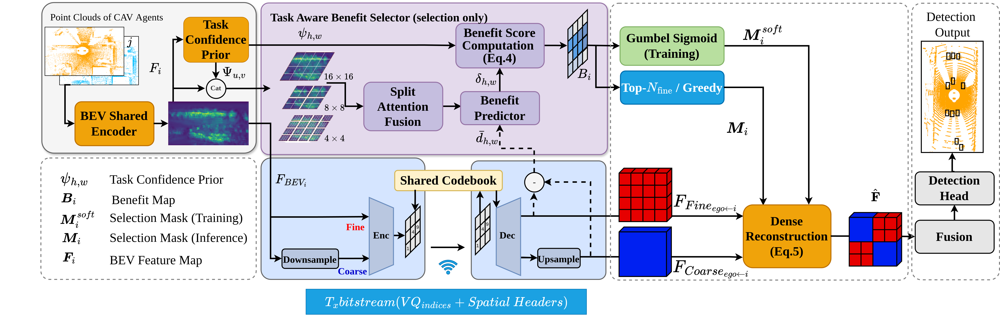

<h1 align="center">ByteCope</h1>

<h2 align="center">Dense Coverage, Sparse Refinement:<br>Byte-Constrained Cooperative Perception</h2>

<p align="center">
  <strong>Melih Yazgan · Timon Müller · J. Marius Zöllner</strong><br>
  FZI Research Center for Information Technology · Karlsruhe Institute of Technology
</p>

<p align="center">
  <strong>Accepted at WACV 2027 — First-round acceptance</strong>
</p>

<p align="center">
  <a href="https://arxiv.org/abs/2609.29456"></a>
  <a href="https://arxiv.org/pdf/2609.29456">Paper + Supplement (PDF)</a>
</p>

Official repository for **ByteCope**. Code release is in preparation.



*Framework overview. Each agent transmits a compressed coarse layer covering the full BEV map and selected fine-resolution patches under a strict byte budget. The receiver reconstructs dense features for fusion and detection.*

## Abstract

Collaborative perception improves autonomous perception by sharing intermediate Bird’s-Eye-View (BEV) features across connected agents, but dense feature exchange is difficult to deploy under strict Vehicle-to-Everything (V2X) bandwidth limits. Existing efficient methods typically either compress the full feature map uniformly, spending bits on low-value background, or sparsify communication, risking the loss of useful context. We propose a coverage-refinement design for byte-constrained cooperative perception: each agent transmits a highly compressed coarse layer over the full BEV map and allocates the remaining budget to selected high-resolution patches. A Task-Aware Benefit Selector ranks cells by estimated downstream utility, enabling deterministic budgeted refinement and zero-retraining adaptation to changing bandwidth. The receiver reconstructs a dense BEV tensor compatible with standard fusion modules. Experiments on DAIR-V2X and OPV2V show strong accuracy–payload trade-offs at kilobyte-scale budgets. On DAIR-V2X, our method reaches 0.60 AP@0.7 at only 1.87 KB per non-ego agent, compared with 0.52 at 4.61 KB for uniform SimVQ compression. Controlled diagnostics further show that the gain arises from coverage–refinement allocation rather than quantization alone. Code will be published.

## News

- Our paper has been accepted at **WACV 2027** in the first round!
- **September 24, 2026:** The [paper and supplementary material](https://arxiv.org/abs/2609.29456) are available on arXiv.

## Release Plan

- [x] Paper and supplementary material
- [ ] Code release — coming soon

## Citation

If you find this work useful for your research, please consider citing our paper:

```bibtex
@misc{yazgan2026densecoverage,
  title         = {Dense Coverage, Sparse Refinement: Byte-Constrained Cooperative Perception},
  author        = {Melih Yazgan and Timon M{\"u}ller and J. Marius Z{\"o}llner},
  year          = {2026},
  eprint        = {2609.29456},
  archivePrefix = {arXiv},
  primaryClass  = {cs.CV},
  url           = {https://arxiv.org/abs/2609.29456}
}
```
